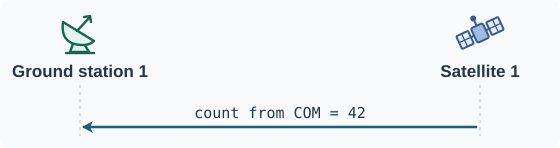
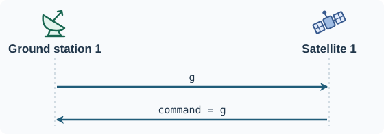
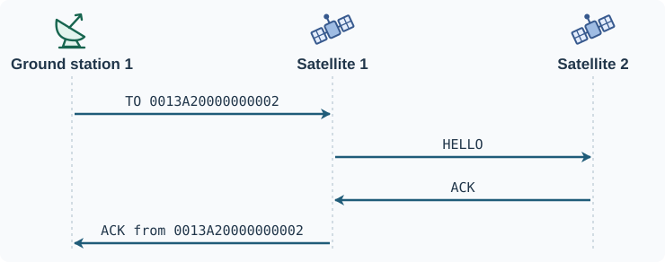
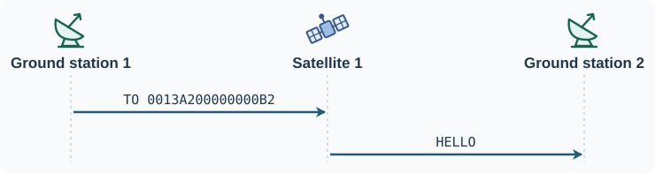
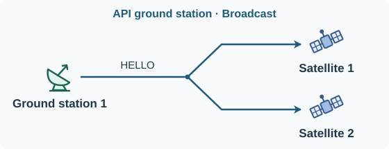

# Communication examples

**Upload [this Lab5-07 sketch](https://github.com/HEPTA-SAT-TRAINING/Lab5-07_Xbee_Api_Mode/tree/feat/zigbee-joint-lab#upload-this-sketch-to-the-satellite) to each participating satellite once.** All four examples use it. If it is already running, start with the monitor.

Typing in a ground station monitor sends to its paired satellite. Use `TO` to tell that satellite where to send its next `HELLO`.

Use the **ground station's USB XBee port** in the [Web Serial Monitor](https://hepta-sat-training.github.io/HEPTA-SAT-Serial_Monitor/) or Arduino Serial Monitor. Disconnect that port in the setup app first. Set **38400 baud** and select **Text** in the web monitor. Use **LF** (Newline) for the commands below. The monitor displays text payloads as sent. A trailing newline keeps successive messages on separate lines.

| From | To | Example |
| --- | --- | --- |
| Satellite 1 | Paired ground station 1 | [Read the counter](#paired-downlink) |
| Ground station 1 | Paired satellite 1 | [Send a one-character command](#paired-uplink) |
| Ground station 1, via satellite 1 | Satellite 2 | [Request a satellite-to-satellite exchange](#satellite-to-satellite) |
| Satellite 1 | Ground station 2 | [Send text to a specific ground station](#addressed-downlink) |
| Ground station 1 | All satellites on the same network | [Broadcast (unsupported in this setup)](#ground-station-broadcast) |

For either `TO` example, join the participating radios to the **same network** first. In setup, connect the destination device and copy its **Radio address** under **Radio details**. Replace the example address with those 16 hex digits.

## Paired downlink



Open monitor 1. The sketch sends a counter approximately once per second:

```cpp
com.printf("count from COM = %lu\n", (unsigned long)++count);
```

Example display: `count from COM = 42`. Ordinary `com.print`, `com.printf` and `com.send` keep using the configured pair (DH/DL), including after another radio joins.

## Paired uplink



In monitor 1, send `g`. Satellite 1 echoes the command and monitor 1 displays `command = g`. The ground station is in Transparent mode and sends typed bytes to its configured pair. Joining a network preserves this destination.

## Satellite to satellite



Run the joint-network sketch on both satellites. In monitor 1, send the following, replacing the address with **satellite 2's**:

```text
TO 0013A20000000002
```

Monitor 1 displays `ACK from` followed by satellite 2's radio address. To try the reverse direction, send `TO` with satellite 1's address from monitor 2.

```cpp
// Receiver, after receive_packet(packet) returns a HELLO.
const uint8_t ack[] = "ACK";
com.send_to(packet.source, ack, sizeof(ack) - 1);
```

## Addressed downlink



Open monitor 2 on ground station 2. In monitor 1, send `TO 0013A200000000B2`, replacing the address with **ground station 2's**. Satellite 1 sends `HELLO` directly to that ground station. Monitor 2 displays `HELLO`. This payload ends without a newline and may appear beside the next telemetry line. A Transparent ground station displays the payload; the application-level `ACK` in the previous example is generated by a satellite sketch.

To send a complete line from the OBC instead, the following is an optional addition at the start of `ground_byte(char c)` in the [Lab5-07 sketch](https://github.com/HEPTA-SAT-TRAINING/Lab5-07_Xbee_Api_Mode/blob/feat/zigbee-joint-lab/Lab5-07_Xbee_Api_Mode.ino). Replace the example address and send `!` from monitor 1:

```cpp
if (ground_used == 0 && c == '!') {
  const uint64_t ground2 = 0x0013A200000000B2ULL;
  const uint8_t message[] = "Hello from satellite 1\r\n";
  if (!com.send_to(ground2, message, sizeof(message) - 1))
    cdh.println("Downlink request rejected");
  return;
}
```

Monitor 2 displays `Hello from satellite 1`. The next normal `com.printf(...)` still goes to ground station 1. A nonzero return from `send_to` is a frame ID; use `com.tx_result()` for the radio delivery status. An application reply is a separate message.

## Ground station broadcast



The dashed arrows show one transmission to every satellite on the same network. With the supplied settings, the ground station sends only to its paired satellite. Joining more satellites does not enable broadcast.

## Build the joint-network sample

[Open the Lab5-07 repository and follow **Upload this sketch to the satellite**](https://github.com/HEPTA-SAT-TRAINING/Lab5-07_Xbee_Api_Mode/tree/feat/zigbee-joint-lab#upload-this-sketch-to-the-satellite).
